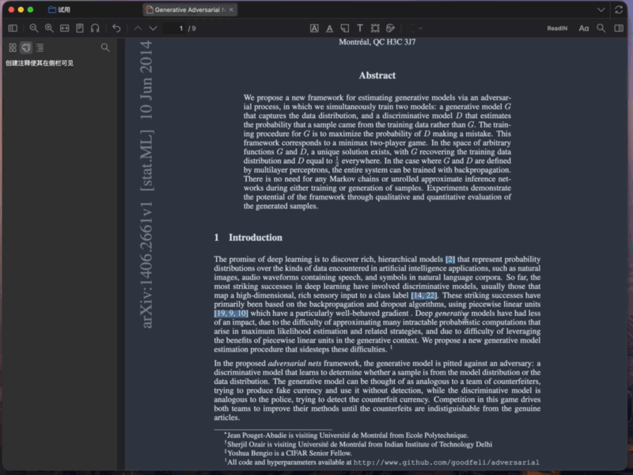

# ReadIN 译读

在 Zotero 里点一下，用 ReadIN 读论文：整页中英对照、AI 讲清这篇说了什么；读完的高亮和笔记自动回到 Zotero。

> **内测中，点这个链接就能用 AI**：[领内测资格](https://beta.anqapdf.app/#ref=cze3sewgik)。不用注册、不用填东西，打开 ReadIN 就自动配好（每月名额有限，领完了下个月再来）。
> 读论文、高亮、笔记回到 Zotero 不用领也能用。

## 为什么用它

- **整页中英对照**：不用一句一句选。整页翻好，原文和译文对着读；在译文上划一句，原文里对应的那句也一起划上。
- **「我不想读，告诉我说了啥」**：一句话让 AI 讲清这篇论文说了什么，摘出关键观点，点一下跳回原文那一句。
- **不用自己弄 API 密钥**：不用去申请 OpenAI、Claude 的密钥，也不用填设置。内测期间点上面的链接就行，正式版登录就能用。
- **导出思维导图**：AI 把你的高亮和想法整理成一张思维导图，能折叠、能「遮住回想」，发给别人双击就能打开。
- **随时问 AI**：选中任何一句都能问，讲术语、拆长句、问这一段在全文里起什么作用。ReadIN 在电脑和 iPad 上都能用。
- **文献不搬家**：Zotero 照旧管文献和引用。在 ReadIN 画的高亮、写的想法变成 Zotero 自己的批注；AI 整理的笔记存成论文下面的一条笔记。

## 三步开始

1. 下载最新的 `readin-yidu-x.y.z.xpi`（在右边的 Releases 里）。
2. Zotero 菜单「工具 → 插件」，把文件拖进去。
3. 在 Chrome 里打开 [ReadIN](https://beta.anqapdf.app)，右上角选「文献」，书架上点「连接 Zotero」。Chrome 会问一次能不能访问这台电脑上的其他应用，点「允许」。

之后在 Zotero 里右键一篇论文，选「在 ReadIN 打开」；或者在 Zotero 的 PDF 阅读器顶栏点「ReadIN」。

## 要知道的

- **两边都要开着**：ReadIN 和 Zotero 在你自己的电脑上直接连，不经过网络，所以要同时开着、在同一台电脑上。Zotero 里新画的高亮，下次在 ReadIN 打开这篇时带过来。
- **支持**：Zotero 10；电脑上的 Chrome。
- **隐私**：插件本身**不连互联网**，只回答 ReadIN 自己的网页，别的网站一律拒绝；代码开源、不混淆、没有统计。用 AI 功能时，你要翻译或提问的文字会经过 ReadIN 的服务发给 AI。
- **收费**：插件免费。ReadIN 正式版有免费额度，用得多可以升级。

## 想聊聊

用着有问题、有想法，都可以找我：

- 微信：扫下面的二维码
- 邮箱：Phoenix@anqalabs.org

ReadIN 里左下角的「吐槽一下」也能直接写给我，我在后台看得到、会回复。

> 这个插件和 Zotero 官方没有关系。Zotero 是 Corporation for Digital Scholarship 的注册商标。

---

## English

**Read your Zotero papers in ReadIN: full-page side-by-side translation, AI that tells you what a paper says, and your highlights and notes flow back into Zotero.**

> **In beta — one click to try the AI features**: [get beta access](https://beta.anqapdf.app/#ref=cze3sewgik). No sign-up: ReadIN opens with AI ready (limited places each month). Reading, highlighting and syncing back to Zotero work without it.

- **Full-page side-by-side translation**: no selecting sentence by sentence. Highlight a sentence in the translation and the matching sentence in the original is highlighted too.
- **"I don't want to read it, tell me what it says"**: AI explains the paper and pulls out key points; click one to jump to the sentence.
- **No API keys to set up**: no OpenAI or Claude keys, no settings. Use the link above during the beta; sign in once it launches.
- **Mind map export**: AI turns your highlights and thoughts into a foldable mind map you can share.
- **Ask AI anywhere**: select any sentence and ask. ReadIN works on desktop and iPad.
- **Your library stays in Zotero**: highlights and notes become native Zotero annotations and a child note.

**Install**: download the `.xpi` from Releases, drag it into Zotero's Tools → Plugins, then open [ReadIN](https://beta.anqapdf.app) in Chrome, switch to Literature mode and click "Connect Zotero".

**Contact**: Phoenix@anqalabs.org, or "Feedback" at the bottom left of ReadIN.

**Privacy**: the plugin makes no internet requests. It answers only ReadIN's own pages on your computer. Open source (AGPL-3.0), no obfuscation, no tracking.

> This plugin is not affiliated with or endorsed by Zotero. Zotero is a registered trademark of the Corporation for Digital Scholarship.

---

## 开发

- `src/bridge.js`：本机入口（列分类和论文、拿 PDF、读写高亮、写笔记）。
- `src/ui.js`：右键菜单和阅读器按钮。
- `python3 dev/test_bridge.py`：在一个隔开的测试用文献库里跑全部测试（不碰你平时用的那个）。
- `python3 build.py`：打包成 `dist/readin-yidu-x.y.z.xpi` 和 `dist/update.json`。

本机入口的规则（2026-11-16 在 Zotero 10 + Chrome 157 上确认）：
- 入口设 `allowRequestsFromUnsafeWebContent`，自己检查 `Origin`，只回答 ReadIN 的网址。
- Zotero 对 `OPTIONS` 预检不回 CORS 头，所以只用不需要预检的请求：GET，和不设类型的 POST（正文是 JSON 文字）。
- Zotero 的本机服务只能回文字，PDF 用 base64url 传。
- Chrome 从网站访问本机要用户允许一次（本机网络权限）。

## 许可证

AGPL-3.0。插件免费、开源；插件里没有任何密钥，也不做收费判断。
